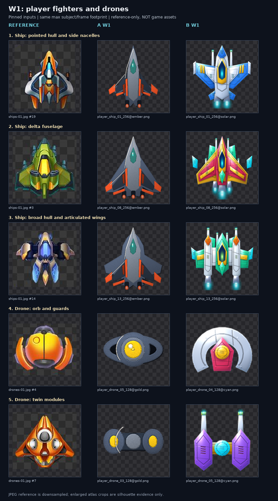

# Audit độc lập A/B — kỹ thuật 2.5D và mĩ thuật thương mại

**Ngày:** 27/10/2026 · **Vai:** Art-style-auditor `arena/65f8a31f` · **Trạng thái:** chốt trên các SHA bên dưới, không suy rộng sang pass tiếp theo.

## 1. Quyết định và thứ tự ưu tiên

**Chưa có lô nào trong hai snapshot này được duyệt.** Cả A W0–W4 và B W0–W5 đều **REDO ở mức lô**: một lô chỉ ĐẠT khi qua **cả** lớp ① kỹ thuật/bằng chứng và lớp ② mĩ thuật, không phải khi đủ file hay một số đo. Điều này không có nghĩa từng pixel phải bỏ đi; các rim, highlight và một số motif có thể giữ khi đội vẽ lại tổng thể. **Curator chưa nhận/chốt các lô này.** A không có W5 trong phạm vi được giao; không coi đó là lỗi thiếu lô.

**P0:** khóa một hero PLAYER đạt hai lớp cho từng hướng, sau đó làm lại W0 theo đúng hero và gameplay thật. **P1:** W2 ENEMY và W3 BOSS sau khi PLAYER được khóa. **P2:** W4/W5 FX, ITEM, BG, UI và các slot trùng chức năng; vẫn là điều kiện chặn nhận lô, không phải việc có thể bỏ. Hướng A vẫn **Ink & Ember tối**, B vẫn **Solar Neon sáng**; yêu cầu nâng cùng ngôn ngữ render, không ép hai bộ giống màu nhau.

Theo director lần 155, calibration đầu tiên là A-redo-W1 `125e1e33` và B-pass-1 `31e237fb`; kết quả REDO cùng năm cặp đã [đăng PR #12](https://github.com/Nthanhbadboy/WindWings-Space-Shooter-game-play/pull/12#issuecomment-6447578001). Director lần 157 yêu cầu lấy nguyên mẫu đã decode làm thước; các anchor `datas/`/sprite-index và cặp theo ID ở dưới dùng nguyên tắc đó. Chưa đánh giá pass-2 đang làm hay bất kỳ commit về sau.

### Phạm vi và anchor có thể kiểm lại

| Nguồn | Snapshot / bằng chứng | Đọc đúng giới hạn |
|---|---|---|
| A | `125e1e33fd485110d94823efa38e745bc04a2cdf` | `art/w0-listing`, `w1-player`, `w2-enemy`, `w3-boss`, `w4-fx-item`; chỉ đọc |
| B | `31e237fb205cf1e7abde03cb4fcec45adb5b4a4d` | `art/w0-listing-b`, `w0-build-icons-b`, `w1-player-b` … `w5-full-b`; chỉ đọc |
| Planner | `100cfcebc38c1aec6dd8dc1cfa62c6aa23f77d86` | `docs/art-plan/ART_REDRAW_PLAN.md`, `art-planner.csv`, **`measure_asset.py` thật**, `gate_batch.py` |
| Spec/nguyên mẫu | `965c770c9ab19846719aeaeae3d6ec56572b0ccd` | `docs/spec/VISUAL_DESIGN.md`, `ART_STUDY.md`; sprite index/contact sheets và capture gốc; `datas/` nêu dưới |
| Điều phối | `8cbc9bae1d9cf739adb9f899d6f51a9ea3a5b497` + PR #12 đến comment `6447652818` | Đã đọc lại `docs/rollout/SESSION_PROMPTS.md`, style-correction 149/154 và director 155/157; các file spec/data/ảnh được dùng không đổi giữa hai SHA spec/điều phối này |

**Anchor nguyên mẫu, không đồng nhất ID:** [STATIC_CONFIRMED] `datas/ships.json` có 25 tàu (`sprite_path_id`/`sprite_name`); `datas/drones.json` có 13 drone; `datas/bosses.json` có 46 dòng, 42 có icon và 41 `sprite_path_id` icon khác nhau; `datas/waves.json` mô tả wave/prefab; `datas/items.json` có sáu nhóm drop, trong đó `Fullpower` có sprite path ID 3944. `datas/sprites.csv` và `docs/assets/sprites-index.csv` nối **tên/path ID gốc → contact sheet/ô**. `AP-*` là ID kế hoạch, **không** phải path ID Unity. Những nguồn này chứng minh danh mục/tên, không tự chứng minh binding mới hay hình thức runtime. `datas/sprite_mesh_contract.json.gz` ghi rõ là tham chiếu mesh serialized **tạm thời**, không phải phê duyệt pivot PNG/scene placement; `scene_sprite_contract.json.gz` cũng không chứng minh visibility runtime.

**[STATIC_CONFIRMED]** Đã xem tám sheet yêu cầu `ships-01`, `drones-01`, `enemy-01`, `bosses-01`, `bullet-01`, `fx-01`, `background-01`, `ui-01`, thêm `items-01` và các sheet `unclassified-02/12/24`; xem bốn capture gameplay gốc `docs/apk-analysis/ramus/2026-10-23-phone/{p_2_Game,slow_8_Game,p_4_Game,live_1_Game}.png`. Đã xem PNG xuất và preview A/B, không chỉ manifest.

**Nhãn bằng chứng:** [STATIC_CONFIRMED] = file/đo/đối chiếu tĩnh có thể lặp; [INFERRED] = nhận định thị giác, không phải dữ kiện engine; [CONFLICTING] = các định nghĩa/chuẩn chưa thống nhất; [UNKNOWN] = chưa có dữ liệu/kiểm định; [RUNTIME_UNVERIFIED] = chưa kiểm gameplay/motion/placement của bản mới; [RUNTIME_CONFIRMED] = **không có** đối với bản mới trong audit này. Ý kiến thương mại là đánh giá độc lập của auditor, không giả nhận có ba người đã thử.

## 2. Verdict từng lô — hai lớp tách biệt

Số `G-G` dưới đây chỉ là số PNG nằm trong **cả ba dải proxy** `grad_stops/outline_px/detail` của planner, theo lớp trong CSV; không phải duyệt toàn bộ kỹ thuật, không tính trần viền 1 px riêng và không phải chấm đẹp. Cảnh W0 không dùng dải sprite.

| Bộ/lô | ① Kỹ thuật + evidence | ② Mĩ thuật | Verdict / việc chặn chính |
|---|---|---|---|
| **A W0 listing** — 25 export | **REDO/chưa đủ chứng minh**: master/cỡ có, nhưng chưa nộp cặp gốc; bốn ảnh tên screenshot là concept, không phải capture Godot. | **REDO**: icon có ánh kim tốt hơn sprite W1, nhưng khung S1/S3 rất tối và trống, tàu nhỏ, ngôn ngữ hero khác bộ chơi. | **REDO P0**; [01_w0, dòng 2–5](comparisons/01_w0.png). Không xuất bản concept làm screenshot. |
| **B W0 listing** — 25 export | **REDO/chưa đủ chứng minh**: có bảng nhưng có cặp không tương đương, cảnh concept không phải gameplay; W0 ảnh không đổi ở snapshot đã pin. | **REDO**: ánh sáng rực/khối dễ thương làm chủ thể chìm trong mật độ nền, chưa đạt độ trưởng thành của gốc. | **REDO P0**; [01_w0, dòng 2–5](comparisons/01_w0.png), giữ hướng sáng nhưng lập lại thứ bậc. |
| **B W0 build icons** — Android + `.ico` | **REDO phụ thuộc W0**: file build icon/master có thật; không từ đó suy ra bộ listing/game được duyệt. | **REDO** cùng thiết kế icon W0. | **REDO P0**; sau khi khóa icon, xuất lại mọi cỡ, kiểm nét ở cỡ nhỏ; không tự nhận đã kiểm tích hợp. |
| **A W1 PLAYER** — 48 PNG, G-G 3/48 | **REDO**: cả 25 tàu có ≥1 proxy ngoài dải; 7/25 proxy viền >1 px; thiếu `masters/` từng slot. | **REDO**: ba mẫu tàu cùng mũi dài, cánh/thân tách đơn giản, cockpit và giáp thiếu quan hệ cơ khí so với gốc. | **REDO P0**; [02_player, dòng 1–5](comparisons/02_player.png), [05_projectiles, 1–2](comparisons/05_projectiles.png). |
| **B W1 PLAYER** — 48 PNG, G-G 1/48 | **REDO**: 25/25 tàu lệch ≥1 dải style; proxy outline 0 không chứng minh không có nét tối dày cục bộ; giữ master. | **REDO**: có nhiều panel/vent và highlight hơn A, nhưng thân–cánh–canopy lặp mẫu, panel như logo/đồ chơi, silhouette chưa đa dạng bằng gốc. | **REDO P0**; cùng [02_player, dòng 1–5](comparisons/02_player.png). |
| **A W2 ENEMY** — 34 PNG, G-G 0/34 | **REDO**: body/đạn có proxy lệch, thiếu bảng gốc và master của lô; AP-0067 cần xác minh nghĩa. | **REDO**: nhiều mắt tròn/phi thuyền hình phẳng, chi tiết kết cấu và thể tích giáp kém hơn các tàu địch tham chiếu. | **REDO P1**; [03_enemy, dòng 1–5](comparisons/03_enemy.png), [05_projectiles, 3–4](comparisons/05_projectiles.png). |
| **B W2 ENEMY** — 34 PNG, G-G 0/34 | **REDO**: bảng nộp ghép nhiều body đơn với nguyên atlas, không phải 3–5 cặp body gần/cùng scale; AP-0067 là HP strip, đo như UI. | **REDO**: core tròn và các cánh đa giác/lỗ vent lặp, thiếu thứ bậc các lớp máy móc của các mẫu gốc. | **REDO P1**; cùng các dòng W2 ở trên. |
| **A W3 BOSS** — 42 PNG, G-G 26/42 | **REDO**: một số dải proxy đạt nhưng không chứng minh gradient/AO theo panel; thiếu bảng của lô và master. | **REDO**: nhiều khối chữ nhật, vòng hoặc côn hình học đơn, chồng giáp và bộ phận nhìn yếu so với icon boss gốc. | **REDO P1**; [11_boss_mapped, ID 7001–7005](comparisons/11_boss_mapped.png) và [04_boss](comparisons/04_boss.png). |
| **B W3 BOSS** — 42 PNG, G-G 4/42 | **REDO**: nhiều proxy ngoài dải; bảng có nhưng phải đối chiếu ID/chi tiết thay vì đếm file bảng. | **REDO**: có khối và vent nhưng nhiều body tái dùng mắt giữa + cánh/thruster, chưa phân cấp cơ khí và đặc trưng của năm boss được map. | **REDO P1**; [11_boss_mapped, dòng 1–5](comparisons/11_boss_mapped.png). |
| **A W4 FX/ITEM** — 35 PNG, G-G 18/35 | **REDO**: thiếu bảng gốc và master; riêng G-A tự báo 35/35 khác kết quả raw của planner 34/35 như §4. | **REDO**: blast/flare nhiều hình sao phẳng; pickup cần phân lớp/vật liệu và phân biệt chức năng rõ hơn. | **REDO P2**; [06_fx_items, dòng 1–5](comparisons/06_fx_items.png). Halo/additive phải test trong engine. |
| **B W4 CORE (UI/FX/BG/ITEM)** — 114 PNG, G-G 57/114 | **REDO**: có bảng nhưng ít nhất phần FX bị ghép logo/glyph làm reference; nền rất sáng cần test foreground, 9-slice chưa test. | **REDO**: BG cyan rất nổi, FX và UI lặp nhiều motif phẳng; vẫn có các điểm sáng hữu ích như halo và gờ nút. | **REDO P2**; [06_fx_items, 1–5](comparisons/06_fx_items.png), [07_b_bg, 1–5](comparisons/07_b_bg.png), [08_b_ui, 1–5](comparisons/08_b_ui.png). |
| **B W5 FULL** — 274 PNG, G-G 89/274 | **REDO**: 96 file lặp byte vượt quá bản đầu tiên trong nội bộ W5; nhiều slot khác nghĩa cần xác nhận chức năng; board chưa chứng minh đủ cặp hợp lệ cho mọi nhóm. | **REDO**: nhiều icon/panel trùng motif sao, planet/nền đơn giản và thiếu cấu trúc gốc. | **REDO P2**; [07_b_bg, 1–5](comparisons/07_b_bg.png), [09_b_w5_fx, 1–4](comparisons/09_b_w5_fx.png), [10_b_w5_semantics, 1–4](comparisons/10_b_w5_semantics.png). |

G-G theo class phải đọc cùng [asset_metrics.csv](asset_metrics.csv), không áp một ngưỡng ship lên FX hay UI. W1 gồm 25 ship, 13 drone, 8 projectile và 2 FX; W2 gồm 23 slot E-BODY và 11 projectile; W3 có 35 body và 7 part. Các lô P1/P2 là verdict cho snapshot hiện có, không yêu cầu mở sản xuất hàng loạt trước khi P0 đã khóa.

## 3. Bằng chứng nhìn cạnh nguyên mẫu

Tất cả **52 hàng** trong [index.csv](comparisons/index.csv) ghi tên file nguồn, ô, tọa độ crop, SHA-256 file tham chiếu và SHA-256 PNG A/B. Bảng dựng bằng [build_comparisons.py](build_comparisons.py); mỗi chủ thể/khung được fit độc lập vào **cùng footprint tối đa**, giữ tỉ lệ, không phải cam kết cùng số pixel gốc hoặc cùng scale thế giới engine. Contact sheet là JPEG/ô 150 px, nhiều sprite bị thu nhỏ: không dùng ảnh phóng to để chứng minh chi tiết hoặc độ dày viền tại kích thước xuất. Nhãn nhỏ `Bg1`/`Bg4` còn trong vài crop nền là chữ của sheet, **không phải nét art**.

- **W0:** [01_w0](comparisons/01_w0.png), **4 cặp cảnh** dòng 2–5: nguyên mẫu gameplay vs A vs B concept. Dòng 1 dùng tàu gốc so **độ hoàn thiện** icon, không giả nhận đó là store icon gốc cùng slot. Khung cảnh và trạng thái không đồng nhất, nên đây là đối chiếu bố cục/thứ bậc, không phải benchmark runtime cân bằng.
- **PLAYER:** [02_player](comparisons/02_player.png), **5 cặp** (3 ship + 2 drone). Chọn tương đồng hình/ vai trò, **không** khẳng định unit_no của hai manifest đã map tới cùng original ship ID; `datas/ships.json` và `datas/drones.json` chỉ cho danh mục ID gốc. [05_projectiles](comparisons/05_projectiles.png) thêm 2 cặp đạn PLAYER.
- **ENEMY:** [03_enemy](comparisons/03_enemy.png), **4 cặp thân** + 1 cặp AP-0067 theo tên; `items-01` #2/#3 là crop sprite đơn rõ hơn các ô atlas, còn #30 chỉ lấy crop nguồn **27×28 px**, dùng đánh giá silhouette, không kết luận chi tiết. [05_projectiles](comparisons/05_projectiles.png) có thêm 2 cặp đạn địch.
- **BOSS:** [11_boss_mapped](comparisons/11_boss_mapped.png), **5 cặp có ID gốc 7001–7005**. Cả hai manifest đều ghi `planner_base=GLYPH-boss-<ID>`; ID đối chiếu `datas/bosses.json` và `sprites-index.csv` → `bosses-01.jpg` #2–#6. Đây là **map manifest**, chưa phải binding runtime. [04_boss](comparisons/04_boss.png) là 5 cặp tương tự hình dáng, không phải map cùng ID. Không yêu cầu copy 1:1: so ngôn ngữ vật liệu, tỷ lệ, phân lớp và độ phong phú.
- **FX/ITEM:** [06_fx_items](comparisons/06_fx_items.png), **5 cặp**; dòng 5 nối `Fullpower` với `datas/items.json`/sprite path 3944, các cặp còn lại là tương đồng vai trò/hình, không chứng minh animation. B W5 thêm [09_b_w5_fx](comparisons/09_b_w5_fx.png), **4 cặp**.
- **BG/UI và chức năng B:** [07_b_bg](comparisons/07_b_bg.png) có **5 cặp** bầu khí, vật thể và hành tinh (có ô trống khi W4 không có asset tương ứng); nền trời vs nebula là **analogue khí quyển**, không phải cùng địa điểm. [08_b_ui](comparisons/08_b_ui.png) có **5 cặp** icon, navigation, crest, frame và bar. [10_b_w5_semantics](comparisons/10_b_w5_semantics.png) có **4 cặp** nguồn cụ thể so với những slot dùng bytes giống nhau; mục đích là đặt câu hỏi chức năng, không suy ra mọi reuse đều sai.



### Phát hiện thị giác có thể hành động

**A PLAYER [INFERRED]:** tàu 01/08/13 có rim và chuyển sáng nên không gọi mọi vùng là phẳng tuyệt đối, nhưng tỷ lệ mũi–thân dài, cockpit nhỏ và cánh rời lặp rõ. So với ship gốc #19/#3/#14, giáp thiếu nhiều cấp trước–sau, greeble chưa gắn với cơ cấu cụ thể. Drone #4/#7 tham chiếu có vỏ lồi và module có chiều sâu; A drone 03/05 là các khối/mắt tối giản. **Sửa:** dựng một hero với thân chính rõ, cockpit tương xứng, cánh có gốc nối, engine/vent/rivet theo luồng lắp ráp; ánh sáng trên, AO tại tiếp xúc, không dùng grain thay panel.

**B PLAYER [INFERRED]:** các thân 01/08/13 có specular, panel line và vent; điểm cộng là đọc sáng và có màu phân vai. Nhưng chúng dùng công thức mũi nhọn/canopy trung tâm/cánh hình học lặp, chuyển tiếp mép và phụ kiện trông như icon dựng sẵn hơn máy bay chiến đấu. **Sửa:** giữ palette B, tăng khoảng giá trị/tương phản **nội bộ từng vật liệu**, độ dày/che khuất giáp, khác biệt cấu trúc cánh/động cơ giữa họ tàu; kiểm tại 64 px. Đối xứng gương đơn lẻ không phải lỗi — vấn đề là sự **lặp máy móc và thiếu logic lớp**, không ép mọi sprite bất đối xứng.

**BOSS [STATIC_CONFIRMED + INFERRED]:** A `boss_dreadnought01_512@ember.png` (manifest `GLYPH-boss-7001`) đo `grad_stops=23`, `outline_px=0,12`, `detail=0,071`, đều trong dải proxy boss 7–25 / 0–1,5 / 0,06–0,32, nhưng ở [cặp ID 7001](comparisons/11_boss_mapped.png) vẫn là khối chữ nhật ít lớp so với mẫu gốc. Đây là ví dụ cụ thể **qua ba số vẫn REDO mĩ thuật**, không phải phủ nhận kết quả máy. B ID 7001–7005 có nhiều vật liệu và gờ hơn, song core tròn/cánh/động cơ lặp, chưa gợi các kết cấu khác nhau ở năm nguyên mẫu. Phần boss detach/destructibility chỉ mới là ảnh/manifest, chưa thể kết luận hành vi.

## 4. Số đo thật, sự khác nhau giữa các gate và giới hạn

**[STATIC_CONFIRMED]** [measure_snapshots.py](measure_snapshots.py) gọi nguyên hàm `measure_png` của planner SHA-256 `c33182347dabf7e1eba4a3278d298a62a89a43ccbc2ae75e3ba0d6181a22b053`, không thay công thức. Đã đọc/đo **682 PNG**: 159 A W1–W4, 512 B W1–W5, 10 ảnh W0 chọn mẫu (5/bộ) và 1 B build icon; **0 lỗi đọc**. Mọi đường dẫn/SHA/kích thước được kiểm lại; CSV chứa từng file thay vì chỉ summary. `alpha > 127` là mask; `val` = HSV V, `val_std` = độ lệch chuẩn V, `dark` = tỉ lệ max(R,G,B)<45, `chroma` = trung bình S×V, `colors` = số màu lượng tử **32 mức mỗi kênh**.

| Mẫu PLAYER | Số planner trên PNG xuất | Dải ship của planner | Diễn giải |
|---|---|---|---|
| A `player_ship_01_256@ember.png` | colors **676**; V **0,511156**; std **0,232132**; grad **38**; outline **1,00**; detail **0,324** | colors 110–160; V 0,46–0,52; std 0,24–0,30; grad 6–25; outline 0–1,5; detail 0,05–0,30 | colors/std/grad/detail ngoài dải; outline trung bình không chứng minh từng nét ≤1 px. |
| B `player_ship_01_256@solar.png` | colors **2063**; V **0,838785**; std **0,163273**; grad **26**; outline **0,00**; detail **0,581** | cùng dải planner ở trên | Style proxy grad/detail lệch; so màu tuyệt đối của B là CONFLICTING như dưới. |

Toàn bộ 25 tàu A: grad trung vị **38** (36–43), outline **0,65** (0,16–1,51), **7/25 >1,00** theo proxy; V trung vị **0,500**, std **0,215**. Toàn bộ 25 tàu B: grad trung vị **26** (23–33), outline **0,00**, detail **0,591**, V **0,808**, std **0,169**. Cả hai **25/25** có ít nhất một proxy style ngoài dải planner. Đây là số đo của **ảnh thật**, không phải số tự khai.

**Giới hạn của chính công cụ:** `grad_stops` đếm số bin V rộng 0,02 chiếm ≥0,8% trên **toàn sprite**, không đếm số gradient liên tục trong từng panel; grain và anti-alias có thể tăng số. `outline_px` là trung bình độ sâu vùng biên rất tối (V<0,18), lấy hướng vào trong ngắn nhất và làm tròn 0,01 px; không phải bề dày tối đa mọi nét, không bắt đầy đủ viền xanh/đỏ tối hay panel bên trong. `detail` là tỉ lệ pixel trong ruột có biên độ V 3×3 ≥0,10, không biết đó là rivet có nghĩa hay nhiễu. Halo có alpha ≤127 bị loại khỏi mask; ảnh nền đục toàn canvas có thể tính biên canvas như biên silhouette, không nên đọc outline đó như nét vẽ sprite. Ba dải G-G được planner neo bằng **mẫu tổng hợp**, chưa chứng minh hiệu chuẩn trên original PNG. Director yêu cầu viền **≤1 px**, nghiêm hơn band planner ship/boss ≤1,5; đo/soát tại kích thước gốc, không suy ngược từ proxy trung bình. Đừng thêm noise hoặc posterize chỉ để kéo số về dải.

**[CONFLICTING — gate A và làm tròn]:** manifest A W1 ghi G-A 48/48 và W2 34/34; tính lại đúng quy tắc tự khai **4 chỉ số `val/std/dark/chroma`, cho phép ≤1 ngoài dải** cũng được 48/48 và 34/34. G-A đó **không** xét `colors`/ba proxy style/G-H/mĩ thuật. A tự báo W3 42/42, W4 35/35; chạy các giá trị raw planner và cùng quy tắc 4 chỉ số thì W3 **40/42**, W4 **34/35**. Nguồn sai khác sát ngưỡng: A `build_w3.py`/`build_w4.py` làm tròn 3 số trước gate; planner so giá trị chưa làm tròn. Ví dụ `boss_spider02` chroma **0,179566** (<0,18) và std **0,198465** (<0,20), trong manifest chroma thành 0,180; `boss_spider03` std **0,199962** thành 0,200; `fx_gatesmall` V **0,900134** thành 0,900. Đây là khác biệt phương pháp, không kết luận gian dối; cần planner/director thống nhất so raw và quy tắc ngưỡng. Dù xử lý ba case này thế nào, verdict mĩ thuật không đổi.

**[CONFLICTING — màu B]:** band `val/chroma/dark` ở planner neo recipe Ink & Ember; director lại cho B chủ ý Solar Neon sáng. Không tự động dùng lỗi palette A để bác B, cũng không bỏ qua yêu cầu thứ bậc gốc trong `ART_STUDY.md` §3.3–3.5 và kiểm gameplay. Ngoài ra B `art/measure_variant_b.py` dùng **16 bin / 1,5%** cho gradient, planner dùng **50 bin rộng 0,02 / 0,8%**; hai số không cùng định nghĩa. Cần planner/director duyệt baseline riêng cho B nếu định chấm tuyệt đối, không tự sửa thang để hợp hình.

### W0 và tương quan với gameplay gốc

[frame_metrics.csv](frame_metrics.csv) là kết quả gọi `measure()` của `tools/design-metrics.py` tại SHA-256 `77bb6a91edd691145924b63dad4c09d95e98c9525390dbbd986d27ca3bddebc7` trên 4 capture gốc và 4 still Huawei của mỗi bộ:

| Nhóm | p95−p05 | `accent_share` mọi hue | detail-gradient |
|---|---:|---:|---:|
| 4 gameplay gốc | 0,511–0,667 | 0,0247–0,0571 | 13,26–20,98 |
| A W0 concept | 0,137–0,467 | 0,0031–0,0388 | 7,85–21,23 |
| B W0 concept | 0,749–0,873 | 0,4594–0,5914 | 55,12–96,15 |

**[INFERRED]** S1/S3 A dễ quá tối/trống; B có nguy cơ quá dày/chói. `VISUAL_DESIGN` §4 đặt mốc cảnh gameplay 0,45–0,80 và detail 13–22 như **cờ xem lại**, nhưng cảnh khác nội dung, 720×1496 so với 450×800 và vẫn chỉ là marketing concept; không gọi đây là kết quả G-C của game mới. Đặc biệt code `accent_share` đếm **mọi hue** với S>0,6 và V>0,6, còn văn bản nói màu nóng: **không** kết luận riêng ngân sách màu nóng bị vi phạm từ con số này.

**[INFERRED, RUNTIME_UNVERIFIED]** B `art/w4-core-b/sprites/bg/bg_parallax_01_sky_far_1024@cerulean.png` có V **0,942556**, std **0,049719**, chroma **0,561300**, trong khi 22 body enemy B có V trung vị **0,758**. Đó là ảnh độc lập/mask khác nhau; gợi ý nguy cơ đảo thứ bậc nền–địch, **không chứng minh** đạn/địch đã chìm khi composite. Cần chụp gameplay thật trên nhiều nền và đo/kiểm bằng mắt.

## 5. Bao phủ, master và mapping chức năng

**[STATIC_CONFIRMED]** Các manifest W1–W4 A liệt kê 48+34+42+35 = **159 PNG**, 159 hash khác nhau; W1–W5 B 48+34+42+114+274 = **512 PNG**, 404 hash khác nhau. Mọi PNG tồn tại, kích thước và byte-size được khai (nếu có) khớp file. B có **512/512 đường `source` master tồn tại**. A có `masters/` W0, nhưng **không có thư mục `masters/` W1–W4** và CSV các lô này không ghi đường source master; code dựng lại là bằng chứng quy trình, chưa thay thế hiển nhiên yêu cầu `masters/` từng slot ở board. A cần nộp master hoặc xin director chấp nhận nguồn lossless tương đương.

25 tên/kích thước/mode export W0 của A và B khớp nhau; kiểm này không bảo đảm store chấp nhận hay artwork đạt. Diff cây W0 exports/masters từ A `4a65378e` → `125e1e33` và B `5510180d` → `31e237fb` rỗng: **không có redraw các ảnh W0 đó trong khoảng này**, dù B có thêm board. Bản gốc chỉ dùng để đo/so nội bộ; **không đưa crop/reference vào store hay asset game**. Quyền tên/art là [UNKNOWN], cần USER xác nhận theo manifest.

**[STATIC_CONFIRMED]** Planner có 443 ID production không tính EXCL/LISTING, tổng `n_units=510`. B có đủ 443 ID qua 512 export; riêng AP-0091 có 3 file parallax so với 1 unit plan, các multiplicity khác khớp. Đây là **coverage ID**, không chứng minh từng file đúng vai trò hay runtime đã nối. W4 B có 102 hash riêng/114 file; W5 có 178/274. Nhóm 22 file W5 cùng SHA-256 `f47957224f4d817cf8b1597949c160dfb1d5986e686e3eefb9cf800dff5bff81` chủ yếu là frame; reuse có thể có chủ ý. Nhóm 13 file cùng SHA `aa0a23ab77e8a85ee888c2c206567f95f8aac8e0ca9877ead919d6f6b088d0af` gồm cả AP-0251 tech node, AP-0264 Blink, AP-0443 ShopIcon, AP-0462 `nennutevent` (tên B: event banner; vai trò cụ thể chưa kiểm runtime). AP-0181 coin icon và AP-0191 coin pack cũng cùng bytes. Hash trùng **không tự động chứng minh sai** khi cùng frame có thể được ghép nhãn/layer động.

**Đối chiếu anchor chức năng [STATIC_CONFIRMED; binding RUNTIME_UNVERIFIED]:** `datas/sprites.csv`/sprite-index cho `Enemy_Hp` path 2554 → `enemy-01.jpg` #2; `ShopIcon` 2871 → `ui-01.jpg` #50; `Blink` 2895 → `unclassified-02.jpg` #57; `Goicoin1` 3045 → `unclassified-12.jpg` #14; `nennutevent` 2943 → `unclassified-24.jpg` #34. Ở [03_enemy dòng 5](comparisons/03_enemy.png), A gán AP-0067 cho orbiter, B gán HP strip; ở [10_b_w5_semantics](comparisons/10_b_w5_semantics.png), basket/panel/flare/coin pile nguyên mẫu khác chức năng trực quan nhưng vài slot B lại cùng một icon. Đây là **cờ cụ thể** yêu cầu kiểm contract và lớp ghép; không tự kết luận `Enemy_Hp` trong game chắc chắn dùng thế nào hoặc B không hoạt động. **Câu hỏi cần USER/nhóm tích hợp xác nhận nếu dữ liệu decode không xác định được:** unit_no W1 map vào 25 sprite ID thế nào, AP-0067 được bind vào thanh HP nào, và các slot trên có được bù bằng layer/text động không? Không nhận các slot đó chỉ dựa vào tên/hash.

B có `preview/*side_by_side_ref.png` nhưng `art/build_side_by_side_boards.py` có phép chọn ô lặp/modulo; kiểm trực tiếp thấy W2 có body đơn đối chiếu cả atlas và W4 FX có ô logo Apple/ký tự. G-H cần **3–5 cặp có nội dung hợp lệ**, không phải chỉ 3–5 file. Board do auditor dựng ở đây giúp chẩn đoán, **không thay thế** trách nhiệm đội nộp board hợp lệ cùng pass sửa.

## 6. Tiêu chí mở lại / handoff cho đội A, B và curator

1. **P0 — hero + W0:** mỗi đội chọn 1 hero, gắn source master/ID, nộp 3–5 cặp gốc tương ứng cùng footprint và PNG kích thước thật. Kiểm silhouette 64 px, cockpit/thân/cánh cân đối, nhiều lớp giáp nối hợp lý, 3–5 mức chuyển sáng liên tục **trên từng panel**, AO tại chỗ chồng, rim trên, vent/rivet/panel-line hợp cơ khí, viền không quá 1 px ở bản xuất. Khóa qua cả hai lớp **trước khi nhân 25 tàu**. Sau đó thống nhất icon/hero/cảnh W0 với tài sản game; chụp screenshot từ build thật trước submission, không dùng concept giả làm capture.
2. **P1 — ENEMY/BOSS:** áp cùng chuẩn 2.5D, phân biệt họ silhouette và part/bộ phận theo role, không nhân một lõi tròn/vỏ đa giác cho mọi mẫu. Giữ ID/binding có căn cứ từ `datas/`/sprite-index; đo từng PNG và ghi các chênh lệch. Với boss, show đủ body và part tách được trong ngữ cảnh, không tự suy từ mock rằng chúng hoạt động.
3. **P2 — FX/ITEM/BG/UI:** lập bảng chức năng cho những slot cùng hash và xác nhận reuse bằng cấu trúc UI/layer; sửa từng slot nếu không phục vụ đúng vai trò, không yêu cầu bịa khác biệt chỉ vì hash giống. Kiểm nền–địch–đạn trong composite, hiệu ứng/trail theo thời gian, và 9-slice ít nhất ba kích cỡ. Không dùng glyph/logo/atlas nguyên trang làm reference cho FX/body.
4. Mỗi lần nộp: kèm `master`, manifest nguồn/license/ID, hash, kết quả planner nguyên bản theo class, và **3–5 cặp thật** cùng loại/scale; định nghĩa ngoại lệ màu B với planner/director. Auditor phải xác nhận **cả kỹ thuật lẫn mĩ thuật** trước khi curator nhận. [UNKNOWN] Chưa có kiểm định ba người “nhìn cùng game”; cần tổ chức và ghi kết quả, không tự nhận PASS.
5. Khi có build thật, dùng `VISUAL_DESIGN.md` §4: **10 frame gameplay + 3 frame thưởng**, `tools/design-metrics.py`, thêm kiểm mắt silhouette/đạn tại 64 px và 0,2 giây trong nhiều nền. Chỉ sau khi thực chạy mới nâng [RUNTIME_UNVERIFIED] lên [RUNTIME_CONFIRMED]; validate pivot/trim, VFX blend và chức năng, không lấy static mock làm bằng chứng.

## 7. Tái lập và CI

Chỉ dùng snapshot/đường dẫn được pin; lệnh dưới không checkout hay sửa nhánh A/B, `docs/spec/`, `datas/`, `tools/`. Đã chạy `measure_asset.py --style-selftest` và `gate_batch.py --selftest` đều exit 0; đã tái tạo byte-identical cả 11 board, index và `frame_metrics.csv`, kiểm hash/crop cho 52 hàng, đo lại bốn PNG mẫu độc lập khớp CSV. Board ID boss thứ 11 được bổ sung sau director lần 157; ID 7001–7005 đã kiểm chéo cả hai manifest với sprite-index.

```bash
# Các commit đã fetch trong repo; ví dụ tái tạo tại thư mục tạm.
ROOT=/tmp/ww-audit-repro
mkdir -p "$ROOT"/{spec,planner,A,B}
git archive 965c770c9ab19846719aeaeae3d6ec56572b0ccd \
  docs/spec/VISUAL_DESIGN.md docs/spec/ART_STUDY.md docs/assets/contact-sheets \
  docs/assets/sprites-index.csv docs/apk-analysis/ramus/2026-10-23-phone \
  tools/design-metrics.py | tar -x -C "$ROOT/spec"
git archive 100cfcebc38c1aec6dd8dc1cfa62c6aa23f77d86 docs/art-plan | tar -x -C "$ROOT/planner"
git archive 125e1e33fd485110d94823efa38e745bc04a2cdf art | tar -x -C "$ROOT/A"
git archive 31e237fb205cf1e7abde03cb4fcec45adb5b4a4d art | tar -x -C "$ROOT/B"
python3 -m venv "$ROOT/venv"
"$ROOT/venv/bin/pip" install 'Pillow==13.0.0' 'numpy==2.4.6'
P="$ROOT/venv/bin/python"
"$P" "$ROOT/planner/docs/art-plan/measure_asset.py" --style-selftest
"$P" "$ROOT/planner/docs/art-plan/gate_batch.py" --selftest
"$P" docs/art-audit/measure_snapshots.py --a-root "$ROOT/A" --b-root "$ROOT/B" \
  --planner "$ROOT/planner/docs/art-plan/measure_asset.py" --out "$ROOT/asset_metrics.csv" --workers 2
"$P" docs/art-audit/measure_frames.py --spec-root "$ROOT/spec" --a-root "$ROOT/A" \
  --b-root "$ROOT/B" --out "$ROOT/frame_metrics.csv"
"$P" docs/art-audit/build_comparisons.py --spec-root "$ROOT/spec" --a-root "$ROOT/A" \
  --b-root "$ROOT/B" --out "$ROOT/comparisons"
```

**CI [UNKNOWN]:** GitHub check-runs tại các head A `125e1e33`, B `31e237fb`, planner `100cfceb` và commit bằng chứng `af684ce14e83c4f03fc9537897941438487b7880` đều được tra và trả **0 check-runs**, không suy diễn CI PASS. Kết quả kiểm local ở trên là static, không phải CI hay runtime. Head cuối của report sẽ được ghi kèm kết quả check-runs theo chính head đó trong comment handoff PR #12.
