# UI — kiến trúc màn hình & luồng điều hướng

> Nguồn: `docs/apk-analysis/08-ui-map.md` (125 class UI), `07-enums.md` (`BoardID`,
> `LoadBoardMode`), `reverse-engineering/il2cpp/dump.cs.gz` (`BoardManager`, `UIManager`,
> `Popup`, `Popup_Notices`). Mọi con số ghi kèm nguồn; suy đoán đánh dấu `> Giả định:`.
> Danh sách máy đọc được: **`docs/spec/screens.csv`** (cùng thư mục).

---

## 0. TL;DR

| Hạng mục | Số lượng | Nguồn |
|---|---:|---|
| Class UI tổng | **125** (nguồn: `08-ui-map.md`) | `08-ui-map.md` |
| Board | **53** (49 board phẳng + 4 class nested/struct) | `08-ui-map.md` |
| Popup | **63** | `08-ui-map.md` |
| Tab | **8** | `08-ui-map.md` |
| Cell | 1 (`Cell_Select`) | `08-ui-map.md` |
| Giá trị `BoardID` | 40 (0…39) | `dump.cs` enum `BoardID` |
| `LoadBoardMode` | 3 (`Single`, `Additive`, `PopUp`) | `dump.cs` enum `LoadBoardMode` |
| Board không có class tương ứng | 6 (`BoardUpgrades`, `BoardFusion`, `BoardDropItems`, `BoardLogIn`, `BoardObstacle`, `BoardTradeDevices`) | đối chiếu §3.1 |

**Đếm lại từ nguồn (vòng 2):** đếm trực tiếp class trong `08-ui-map.md` → **125 class**
(53 board + 63 popup + 8 tab + 1 cell). Trong 53 board có 4 class nested/struct
(`Board_Arena.ArenaRewards`, `Board_BattlePassPro.BattlePassMission`,
`Board_EventSeasonPass.EventRewards`, `Board_Reborn.SortPlayerLevelStruct`) — nếu chỉ đếm
board phẳng thì được **49**. Cả hai con số đều đúng, khác cách đếm.

Bổ sung bằng chứng từ SO: `Shop_Cell` có **315 ô** trải trên **20 board**
(`Shop_Cell.csv`) — xác nhận board nào cũng có cell bán hàng, khớp sơ đồ §2.

> **Đối chiếu độc lập (`class-inventory.csv`, 677 class có instance):** lọc theo tiền tố
> `Board_` **46** · `Popup_` **60** + `Popup` **1** · `Tab_` **8** · `Cell_` **1** = **116**.
> Chênh 9 so với 125 vì file inventory chỉ đếm **MonoBehaviour có instance trong
> `data.unity3d`**; 9 class còn lại là **nested/struct** (4 board nested đã nêu) và các class
> UI không gắn vào GameObject nào. Hai nguồn **không mâu thuẫn**, chỉ khác định nghĩa "class UI".

### 0.1 Đọc `screens.csv`

| Cột | Ý nghĩa | Quy ước |
|---|---|---|
| `class` | tên class C# trong `08-ui-map.md` | giữ nguyên, kể cả nested (`Board_Arena.ArenaRewards`) |
| `board_id` | giá trị `BoardID` tương ứng | `—` nếu không có enum (popup, tab, board mới) |
| `mo_tu_dau` | board/nút mở ra nó | suy từ field `btn*`/`coverBtn*` của board cha |
| `popup_con` | popup mở từ board này | `Popup_X` = map được class; `~popupY` = **field có thật nhưng chưa tìm được class** |
| `data_can_load` | ScriptableObject/manager cần có sẵn | tên class, không phải đường dẫn file |

125 dòng = 53 board + 63 popup + 8 tab + 1 cell.

---

## 1. Kiến trúc runtime

### 1.1 `BoardManager` (MonoBehaviour, TypeDefIndex 101)

```
BoardManager
├─ parentBoards : Transform           // nơi gắn board con
├─ boardsPrefabs : UIBoard[]          // toàn bộ prefab board
├─ listBoards : Dictionary<string, GameObject>
├─ listBoardsPrefabs : Dictionary<string, string>
├─ listBoardsOpened : static List<BoardID>   // ← back stack
├─ currentBoard : static BoardID
├─ interactable : static bool         // chặn double-tap khi đang chuyển
├─ loading : GameObject               // overlay loading
├─ fading : Coroutine
├─ boardHome / boardMaps / menuObject
├─ boardPause / boardReborn / boardRebornIAP   // static, giữ ref nóng
└─ isReady : static bool
```
Nguồn: `dump.cs` `public class BoardManager : MonoBehaviour`.

Hàm API:

| Hàm | Vai trò |
|---|---|
| `OpenBoard(object)` / `CloseBoard(object)` | entry từ event UI (truyền `BoardID`) |
| `LoadSingle(BoardID)` + `GetAndOpenBoardSingle` | `LoadBoardMode.Single` |
| `LoadAdditive(BoardID)` + `GetAndOpenBoardAdditive` | `LoadBoardMode.Additive` |
| `LoadPopUp(BoardID)` + `GetAndOpenBoardPopUp` | `LoadBoardMode.PopUp` |
| `CloseBoard(BoardID)` | đóng board cụ thể |
| `GetPreviousBoard()` | đọc phần tử kế cuối của `listBoardsOpened` → **back stack thật** |
| `IsOpenBoard(BoardID)` | kiểm tra board đã mở |
| `SetBoardActive(object)` | bật/tắt theo `BoardID` |
| `Escape(object)` | nhận phím back Android |
| `CheckFade(BoardID)` / `FadeOff()` / `FadeLoading(a1,a2,callback,delta=0.1)` | hiệu ứng mờ, mặc định **0.1 s** |

### 1.2 Ba `LoadBoardMode` — khác nhau ở chỗ **có destroy hay không**

| Mode | Hành vi suy ra từ code | Dùng cho |
|---|---|---|
| `Single = 0` | Ẩn board hiện tại, **destroy** board cũ, mở board mới trên `parentBoards`; đẩy `BoardID` vào `listBoardsOpened` | Board lớn: `Board_Home → Board_Maps → Board_Stage` |
| `Additive = 1` | **Không destroy** board dưới, mở chồng lên (giữ state + giữ render) | Board cần quay lại tức thì: `Board_Shop*`, `Board_Vip`, `Board_TechLab` |
| `PopUp = 2` | Mở dạng modal, có `Canvas` + `GraphicRaycaster` riêng, chặn input board dưới | 63 `Popup_*` + board dạng popup (`Board_Pause`, `Board_Endgame`, `Board_Reborn`) |

> **Giả định:** tên 3 mode khớp đúng ngữ nghĩa Unity `LoadSceneMode`; phần thân hàm
> `LoadSingle/LoadAdditive/LoadPopUp` không đọc được (IL2CPP strip) nên **chi tiết destroy
> vs hide phải kiểm bằng test**, không khẳng định 100%.

**Quy tắc destroy vs hide (đề xuất spec hoá):**

| Loại board | Destroy khi đóng? | Lý do |
|---|---|---|
| `Board_Home` | **Không** (giữ nóng, static `boardHome`) | luôn là đích quay về |
| `Board_Maps`, `Board_Stage`, `Board_Chapters` | **Có** (Single) | dữ liệu đổi theo tiến trình |
| `Board_Shop`, `Board_ShopCoins`, `Board_ShopGems`, `Board_ShopEnergy` | **Không** (Additive) | mở từ nhiều nơi, cần giữ scroll |
| `Board_Pause`, `Board_Endgame`, `Board_Reborn`, `Board_Reborn_IAP` | **Không** (giữ static ref) | mở giữa trận, cấm load lại scene |
| 63 `Popup_*` | **Có** (pool 1 instance/loại) | tránh leak, tránh double-popup |
| `Popup_Notices` | **Không** — dùng lại 1 instance | base popup cho 20+ trường hợp lỗi |

### 1.3 `UIManager` (TypeDefIndex 1493) — không phải board manager

```
UIManager
├─ removeAdsEvent : Action
├─ exitEvent : Action
├─ nativeAd : UINativeAd
└─ Escape(object)   // cùng tên với BoardManager.Escape
```
Hàm: `ShowMenu(Action removeAdsEvent, Action exitEvent)`, `HideMenu()`, `RemoveAds()`.

⇒ `UIManager` **chỉ quản menu + quảng cáo native/cross-ad**, không quản board.
Đừng nhầm với `BoardManager` khi dựng lại kiến trúc.

`UINativeAd` có `uICrossAd`, `adNativePanel`, `adCrossPanel`, `adImage`, `adIcon`,
`adChoices`, `adHeadline`, `adCallToAction`, `adBodyText`, `adCrossImage`, `adCrossBg`,
`linkCrossAd`, `indexAd` + `DisplayNativeAds()`, `DisplayCrossAds()`, `OnClickCrossAd()`.
⇒ Có **2 loại quảng cáo**: native (banner trong board) và cross-ad (popup chéo).

### 1.4 `Popup` base class (TypeDefIndex ~ 40547)

| Field/Method | Ý nghĩa |
|---|---|
| `anim` | Animator của popup |
| `animEventCallback` | callback khi animation đóng xong |
| `OnPressedButtonExit()` | đóng popup, gọi `animEventCallback` |
| `OffBoard()` | tắt board |

`Popup_Notices` (base cho ~20 popup lỗi/thông báo) có thêm:

| Field/Method | Ý nghĩa |
|---|---|
| `textHeader`, `textInfo` | 2 dòng text |
| `exitAfterConfirm : bool` | bấm Confirm thì tự đóng |
| `confirmAction`, `exitAction` | callback |
| `SetPopup(header, info, confirm, exit, exitAfterConfirm)` | API dựng popup động |
| `NoGems()`, `NoCoins()` | preset lỗi thiếu tiền tệ |
| `OpenShopGems()`, `OpenShopCoins()` | nhảy sang shop tương ứng |

⇒ **Đây là "1 popup, 20 ngữ cảnh"**: spec nên làm 1 component `NoticePopup` với
`SetPopup(...)` thay vì 20 prefab riêng.

---

## 2. Sơ đồ màn hình

```mermaid
graph TD
  Splash[Splash / Loading] --> Home[Board_Home]

  Home -->|coverBtnArena| Arena[Board_Arena]
  Home -->|coverBtnPvP| PvP[Board_PVP]
  Home -->|btnPlay / txt_label_play| Maps[Board_Maps]
  Home -->|txt_label_shop| Shop[Board_Shop]
  Home -->|OnPressedButtonDevices| Devices[Board_Devices]
  Home -->|OnPressedButtonDrones| Drones[Board_Drones]
  Home -->|slot tàu| Players[Board_Players]
  Home -->|txt_label_quest| Quest[Board_Quest]
  Home -->|btnTechLab| TechLab[Board_TechLab]
  Home -->|OnPressedButtonVip| Vip[Board_Vip]
  Home -->|dotFocusGiftLogin| GiftLogin[Board_GiftLogin]
  Home -->|btnSettings| Setting[Board_Setting]
  Home -->|gói combo| Combo[Board_Combo]
  Home -->|mini combo| MiniCombo[Board_MiniCombo]
  Home -->|avatar| UserProfile[Board_UserProfile]

  Maps --> Stage[Board_Stage]
  Maps --> SelectBoss[Board_SelectBoss]
  Maps --> Chapters[Board_Chapters]
  Maps --> Challange[Board_Challange]
  Maps --> Survival[Board_Survival]
  Maps --> Ranks2[Board_Ranks]
  Maps --> BP[Board_BattlePass]
  Maps --> BPPro[Board_BattlePassPro]
  Maps --> EventSP[Board_EventSeasonPass]

  SelectBoss --> FightBoss[Board_FightBoss]
  Stage --> Begin[Board_Begin]
  FightBoss --> Begin
  Begin --> Game[[In-game: GP_Controller]]

  Game --> Pause[Board_Pause]
  Game --> Endgame[Board_Endgame]
  Game --> Reborn[Board_Reborn]
  Reborn --> RebornIAP[Board_Reborn_IAP]
  Endgame --> Home
  Pause --> Home

  Shop --> ShopCoins[Board_ShopCoins]
  Shop --> ShopGems[Board_ShopGems]
  Shop --> ShopEnergy[Board_ShopEnergy]
  Shop --> BigShop[Board_BigShop]
  Devices --> SellDevices[Board_SellDevices]
  Devices --> BlackBox[Board_BlackBox]
  Drones --> Droids[Board_Droids]
  Players --> Cards[Board_Cards]
  Quest --> QuestRewards[Board_QuestRewards]
  BattlePassNote[[BP dùng Tab_BattlePass / Tab_BattlePassMission]]
  BP --- BattlePassNote
  Arena --> ArenaShop[[Popup_ArenaShopExchange]]
  PvP --> Room[Board_RoomPVP]
  Room --> YourTeam[Board_YourTeam]
  PvP --> PvPRanks[[Popup_PvPRankings]]
  Setting --> Settings2[Board_Settings]
  Setting --> Profile[Board_Profile]
  Setting --> Account[Board_AccountSettings]
  Account --> Link[Board_LinkAccount]
  Items[Board_Items] --- Home
  Winner[Board_WinnerBenefits] --- Arena
```



Nguồn: quan hệ board ↔ board lấy từ `08-ui-map.md` (field btn/popup của từng class);
in-game lấy từ `GP_UI` / `GP_Endgame` / `Player_Health.OnDie` (dump.cs).

---

## 3. 53 board — nhóm theo hub

| Hub | Board con | Số |
|---|---|---:|
| **Home** | `Board_Players`, `Board_Drones`, `Board_Devices`, `Board_Cards`, `Board_Quest`, `Board_TechLab`, `Board_Vip`, `Board_GiftLogin`, `Board_Setting`, `Board_Combo`, `Board_MiniCombo`, `Board_UserProfile`, `Board_Items` | 13 |
| **Maps** | `Board_Stage`, `Board_Chapters`, `Board_SelectBoss`, `Board_Challange`, `Board_Survival`, `Board_Ranks`, `Board_BattlePass`, `Board_BattlePassPro`, `Board_EventSeasonPass` | 9 |
| **Shop** | `Board_Shop`, `Board_ShopCoins`, `Board_ShopGems`, `Board_ShopEnergy`, `Board_BigShop` | 5 |
| **Devices/Drones** | `Board_Droids`, `Board_SellDevices`, `Board_BlackBox` | 3 |
| **Arena/PvP** | `Board_Arena`, `Board_PVP`, `Board_RoomPVP`, `Board_YourTeam`, `Board_WinnerBenefits` | 5 |
| **In-game** | `Board_Begin`, `Board_Pause`, `Board_Endgame`, `Board_Reborn`, `Board_Reborn_IAP`, `Board_FightBoss` | 6 |
| **Setting/Account** | `Board_Settings`, `Board_Profile`, `Board_AccountSettings`, `Board_LinkAccount` | 4 |
| **Root + reward** | `Board_Home`, `Board_QuestRewards`, `Board_Arena.ArenaRewards`, `Board_BattlePassPro.BattlePassMission`, `Board_EventSeasonPass.EventRewards`, `Board_Reborn.SortPlayerLevelStruct` | 6 |
| **Tổng** | | **53** |

Board "hub" (mở nhiều con nhất): `Board_Home` (**14** đích), `Board_Maps` (**9**),
`Board_Shop` (**4**), `Board_Setting` (**3**) (nguồn: đếm field `btn*` trong `08-ui-map.md`).

### 3.1 Board ↔ `BoardID` — 6 điểm lệch

| `BoardID` (enum) | Class thực tế | Ghi chú |
|---|---|---|
| `BoardUpgrades = 2` | **không có** | chức năng nâng cấp nằm trong `Board_Players` |
| `BoardFusion = 11` | `Board_BlackBox` | tên class khác enum |
| `BoardDropItems = 15` | `Board_Items` | |
| `BoardLogIn = 24` | `Board_GiftLogin` | |
| `BoardObstacle = 27` | **không có** | dùng `Board_Survival` với `EndlessType.Obstacle` |
| `BoardTradeDevices = 38` | `Board_SellDevices` | |

Nguồn: `dump.cs` enum `BoardID` + `08-ui-map.md`.

⇒ Khi dựng lại: **giữ enum `BoardID` 1:1** (để save/data cũ đọc được), nhưng đặt tên class
theo bảng trên. Đừng đổi enum — sẽ vỡ dữ liệu `PlayerPrefs`/cloud save.

---

## 4. 63 popup — phân loại & điều kiện bật

**5 nhóm:**

| Nhóm | Ký hiệu | Đặc điểm UI | Ví dụ |
|---|---|---|---|
| Xác nhận | `C` | 2 nút (Confirm / Exit), `exitAfterConfirm` | `Popup_Confirm` |
| Phần thưởng | `R` | lưới item + nút Claim | `Popup_PVPRewards` |
| Chào bán | `O` | giá + nút mua + countdown | `Popup_ShipSalePack` |
| Lỗi / chặn | `E` | 1 nút, không có lựa chọn | `Popup_Notices` (NoGems) |
| Thông tin | `I` | chỉ đọc, 1 nút đóng | `Popup_ArenaInfo` |

| # | Popup | Nhóm | Mở từ | Điều kiện bật |
|---:|---|:---:|---|---|
| 1 | `Popup_AbilityEvent1` | **I** | Board_Maps (btnAbilityEvent1/2) | Có event ability đang mở |
| 2 | `Popup_About` | **I** | Board_Setting | Bấm About |
| 3 | `Popup_ArenaInfo` | **I** | Board_Arena | Bấm nút Info — hiện luật `txt_rule_desc1..6` |
| 4 | `Popup_ArenaShopExchange` | **O** | Board_Arena | Có `ArenaMedal` > 0 |
| 5 | `Popup_Ban` | **E** | Board_Profile, Board_Arena, Board_PVP | Tài khoản bị ban (server trả cờ) |
| 6 | `Popup_BattlePassLevelUp` | **R** | Board_BattlePassPro | Vừa lên level BP |
| 7 | `Popup_BuyEnergy` | **O** | Board_Stage/Board_Challange/Board_Reborn | `Energy` < cost |
| 8 | `Popup_BuyItem` | **O** | Board_Begin | Thiếu item trước trận |
| 9 | `Popup_BuyMoreChanceAbility` | **O** | Board_Begin | Hết lượt chọn ability |
| 10 | `Popup_BuyMoreCoins` | **O** | Board_Endgame, Board_ShopCoins | Bấm "+" coin |
| 11 | `Popup_BuyMoreGems` | **O** | Board_ShopGems | Bấm "+" gem |
| 12 | `Popup_BuySpeed` | **O** | Board_GiftLogin | Mua x2 tốc độ nhận gift |
| 13 | `Popup_ChangeAvatar` | **I** | Board_UserProfile | Bấm avatar |
| 14 | `Popup_ChangeLanguages` | **I** | Board_Setting, Board_Settings | Bấm Languages |
| 15 | `Popup_ChangeMissions` | **I** | Board_BattlePassPro | Bấm đổi nhiệm vụ |
| 16 | `Popup_CheatTime` | **E** | Board_Home, Board_Endgame | Phát hiện đổi giờ máy (`RankManager.GetTimeOnline`) |
| 17 | `Popup_ChooseVersionDatas` | **C** | Board_Arena, Board_PVP, Board_Ranks, Board_Profile | Có ≥2 bản save cloud |
| 18 | `Popup_Community` | **I** | Board_Setting | Bấm Community |
| 19 | `Popup_Confirm` | **C** | Nhiều board | Bất kỳ hành động cần xác nhận |
| 20 | `Popup_ConfirmRate` | **C** | Popup_Rate | Bấm "Đánh giá ngay" trong `Popup_Rate` |
| 21 | `Popup_CrossLinks` | **I** | Board_Setting | `popupCrossAds` — mở link đối tác |
| 22 | `Popup_DroneCraft` | **O** | Board_Drones | Bấm `btnOpenCraft` |
| 23 | `Popup_EventLevelUp` | **R** | Board_Maps | Event ability lên level |
| 24 | `Popup_Exchange` | **O** | Board_EventSeasonPass | Có `CoinEvent1` |
| 25 | `Popup_FirstGiftFree` | **O** | Board_Home | Lần đầu mở game (chưa nhận) |
| 26 | `Popup_FirstPurchase` | **O** | Board_Home | Chưa từng mua IAP |
| 27 | `Popup_Fotification` | **I** | Board_Maps | Đủ `StarCount` để mở vùng |
| 28 | `Popup_GeneralSettings` | **I** | Board_Setting | Bấm Settings |
| 29 | `Popup_HolidayGift` | **O** | Board_Home | Đúng ngày lễ (so date máy) |
| 30 | `Popup_InfoDevices` | **I** | Board_Players, Board_Devices | Bấm icon device |
| 31 | `Popup_InrerestExpired` | **O** | Board_Maps/Stage/Challange | Offer "quan tâm" hết hạn |
| 32 | `Popup_JoinRank` | **C** | Board_Ranks | Bấm tham gia ranking |
| 33 | `Popup_LuckyStar` | **R** | Board_Home, Board_Shop | Có lượt Lucky Star |
| 34 | `Popup_NewPlayer` | **R** | Board_Players/Drones/Combo | Mở tàu/drone mới |
| 35 | `Popup_Notice` | **I** | Nhiều board | Thông báo 1 nút (base) |
| 36 | `Popup_Notices` | **E** | 20+ board | Lỗi chung: `NoGems()`, `NoCoins()`, no internet, init fail… |
| 37 | `Popup_PVPContinue` | **C** | In-game PvP | Hết trận PvP, hỏi tiếp |
| 38 | `Popup_PVPRewards` | **R** | Board_PVP, Board_Survival | Kết thúc mùa/trận |
| 39 | `Popup_PVPShopExchange` | **O** | Board_PVP | Có `PvPMedal` |
| 40 | `Popup_Penalty` | **E** | Board_Home, Board_Endgame | Anti-cheat phát hiện sửa dữ liệu |
| 41 | `Popup_PremiumDailyRewards` | **R** | Board_Home | `IsCollectPremiumDailyGift` = true |
| 42 | `Popup_PremiumExpired` | **O** | Board_Home | `IsPremiumExpired` = true |
| 43 | `Popup_Profile` | **I** | Board_Arena/PVP/Ranks/PvPRankings | Bấm avatar người khác |
| 44 | `Popup_PvPRankings` | **I** | Board_PVP | Bấm Rankings |
| 45 | `Popup_QuitEvent` | **C** | Board_Pause, Board_Reborn | Đang trong event, hỏi thoát |
| 46 | `Popup_QuitGame` | **C** | Board_Home | Bấm Back ở Home |
| 47 | `Popup_Rate` | **O** | Board_Home | `VictoryCount ≥ RateStepCount × PopRateCount` |
| 48 | `Popup_Redeem` | **I** | Board_Setting | Bấm Redeem code |
| 49 | `Popup_Rename` | **I** | Board_UserProfile | Bấm tên |
| 50 | `Popup_SeasonRewards` | **R** | Board_Arena, Board_Ranks | Cuối mùa |
| 51 | `Popup_SelectBenefits` | **O** | Board_WinnerBenefits | Có medal, chọn 1 trong N quà |
| 52 | `Popup_SelectItemCombo` | **O** | Board_Home | Bấm combo item |
| 53 | `Popup_SelectShipCombo` | **O** | Board_Home | Bấm combo tàu |
| 54 | `Popup_ShipSalePack` | **O** | Board_Home, Board_Players | Có pack sale tàu đang bật |
| 55 | `Popup_Support` | **I** | Board_Setting | Bấm Support (mở URL) |
| 56 | `Popup_TrialExpried` | **E** | Board_Players | Hết hạn dùng thử tàu (`ShipTrial`) |
| 57 | `Popup_TryShip` | **O** | Board_Players, Board_GiftLogin | Bấm Try trên tàu chưa mua |
| 58 | `Popup_Update` | **E** | Board_Home | Có version mới trên store |
| 59 | `Popup_UpgradeTechIAP` | **O** | Board_TechLab | Chạm trần tech, cần IAP |
| 60 | `Popup_VideoCards` | **O** | Board_Home, Board_Drones | Xem video lấy card (AdPos.FreeCards) |
| 61 | `Popup_WatchVideos` | **O** | Board_Home | Bấm nút video |
| 62 | `Popup_WatchVideosOld` | **O** | Board_Home | Legacy, còn giữ để tương thích save |
| 63 | `Popup_WeekSales` | **O** | Board_Home, Board_Shop | Pack tuần (`txt_packname_weekly0..4`) |

**Đếm theo nhóm:** C = 7, R = 7, O = 26, E = 6, I = 17 (tổng **63**).
Nguồn: `08-ui-map.md` (field `popup*`), phân nhóm theo tên + field của class.

---

## 5. Tab (8) — widget con, không phải board

| Tab | Nằm trong | Nội dung |
|---|---|---|
| `Tab_BattlePass` | `Board_BattlePass` | track reward thường |
| `Tab_BattlePassPro` | `Board_BattlePassPro` | track reward Pro |
| `Tab_BattlePassMission` | `Board_BattlePassPro` | danh sách nhiệm vụ (`BATTLEPASS_MISSION_*`) |
| `Tab_Boss` | `Board_SelectBoss` | 46 wave-boss (`Data_Boss.allBosses`) |
| `Tab_Item` | `Board_Items` | 6 item (`Data_Items`) |
| `Tab_LogIn` | `Board_GiftLogin` | 30 ô đăng nhập |
| `Tab_Manager` | `Board_Shop`, `Board_Combo`, `Board_GiftLogin` | chuyển tab theo `ShopTab` |
| `Tab_Button` | nhiều board | nút tab generic |

Nguồn: `08-ui-map.md` (8 class `Tab_*`). `ShopTab` enum: `Coins`, `Gems`, `Gift`, `Sale`
(nguồn: `07-enums.md`).

---

## 6. Wireframe note — suy ra từ field, **không copy pixel**

> Yêu cầu bắt buộc: các ghi chú dưới đây suy ra **từ tên field serialize** trong
> `08-ui-map.md`, không phải từ ảnh chụp game. Không dùng lại layout/asset gốc.

### 6.1 `Board_Home` — 6 vùng chức năng (suy từ field)

| Vùng | Field chứng minh | Nội dung |
|---|---|---|
| Top bar | `txtLabelCoins`, `txtLabelGems`, `txtLabelEnergy`, `btnAddEnergy`, `btnAddGems` | 3 tài nguyên + nút "+" |
| Trung tâm | `parentDrones`, `slotPlayer`, `btnPlay`, `txtLabelPlay` | tàu + 2 drone + nút Play to |
| Trái | `coverBtnArena`, `coverBtnPvP`, `txtLabelArena`, `txtLabelPvP` | 2 nút mode PvP |
| Phải | `btnSettings`, `btnVip`, `btnQuest`, `btnDrones`, `btnDevices`, `btnShop` | cột icon dọc |
| Đáy | `btnGiftLogin`, `dotFocusGiftLogin`, `btnBattlePass` | gift + BP |
| Overlay | `m_PopupWatchVideos`, `popupRate`, `popupPremium`, `autoPopup` | popup tự bật |

### 6.2 `Board_Maps` — 3 tầng

`chaptersScroll` → `stageScroll` (trong `Board_Stage`) → `waveList`; nút mode
(`btnChallange`, `btnSurvival`, `btnFightBoss`, `btnRanks`, `btnBatlePass`) tách khỏi scroll.

### 6.3 `Board_Begin` — modal trước trận

Có `popupTalents`, `popupIAP`, `popupScript`, `popupEvent1/2` ⇒ đây là màn **chọn
ability/talent + bán item** trước khi vào trận, không phải màn loading. Layout: 3 slot
ability + 1 nút Play + nút mua booster.

### 6.4 `Board_Endgame` — màn kết trận

`popupPremiumRewardsPREMIUM` / `…GIFT` / `…ForEnglish` (3 biến thể text theo locale/version)
+ `popupRate` + `popupConfirmBuy` ⇒ layout 1 cột: kết quả → reward → offer → nút Next.

### 6.5 Nguyên tắc dựng lại UI (khác bản gốc)

| Nguyên tắc | Lý do |
|---|---|
| **Không** dùng lại sprite/atlas của WindWings | bản quyền GCenter (xem `ASSETS.md` §legal) |
| Giữ **cấu trúc 3 mode load board** | đã tối ưu cho mobile, dễ port |
| Gom 20 popup lỗi thành **1 `NoticePopup`** | giảm 20 prefab → 1 |
| Đặt tên class theo bảng §3.1 | đọc code cũ vẫn hiểu |
| 1 board = 1 prefab + 1 script, không nested prefab board | tránh lỗi destroy |

---

## 7. Luồng đặc biệt

### 7.1 Back stack (`listBoardsOpened`)

```
Open(Home)                → [Home]
Open(Maps, Single)        → [Home, Maps]
Open(Stage, Single)       → [Home, Maps, Stage]
Open(Begin, PopUp)        → [Home, Maps, Stage, Begin]
Close(Begin)              → [Home, Maps, Stage]
GetPreviousBoard()        → Stage   ← dùng cho nút Back
```
Nguồn: `BoardManager.listBoardsOpened` + `GetPreviousBoard()` (`dump.cs`).

**Ngoại lệ:** trong 125 class đã đọc, **không thấy nơi nào pop `Board_Home`** — `Escape` ở `Board_Home` mở
`popupQuitgame` thay vì thoát.

### 7.2 Mở board từ nhiều nơi (6 board "đa điểm vào")

| Board | Số điểm vào | Danh sách |
|---|---:|---|
| `Board_Shop` / `Board_BigShop` | 4 | `Board_Home`, `Board_Arena`, `Board_PVP`, `Popup_Notices.OpenShopGems` |
| `Board_ShopEnergy` | 3 | `Board_Home`, `Board_Stage`, `Popup_BuyEnergy` |
| `Board_TryShip` | 2 | `Board_Players`, `Board_GiftLogin` |
| `Board_Vip` | 2 | `Board_Home`, `Popup_ReachVip` |
| `Board_BattlePass` | 2 | `Board_Home`, `Board_Maps` |
| `Board_Profile` | 4 | `Board_Arena`, `Board_PVP`, `Board_Ranks`, `Popup_PvPRankings` |

⇒ 6 board này **phải dùng `Additive`**, nếu `Single` sẽ mất scroll/state của board gọi nó.

### 7.3 Popup theo mode

| Mode | Popup riêng |
|---|---|
| Arena | `Popup_ArenaInfo`, `Popup_ArenaShopExchange`, `Popup_SeasonRewards`, `Popup_JoinRank`, `Popup_Profile`, `Popup_PvPRankings` |
| PvP | `Popup_PVPContinue`, `Popup_PVPRewards`, `Popup_PVPShopExchange`, `Popup_RoomInfo`, `Popup_SelectRival`, `Popup_PvPRankings` |
| Battle Pass | `Popup_BattlePassLevelUp`, `Popup_ChangeMissions`, `Popup_SelectBenefits`, `Popup_SeasonRewards` |
| In-game | `Popup_Penalty`, `Popup_BuyEnergy`, `Popup_QuitEvent`, `Popup_PVPContinue` |

Nguồn: field `popup*` của `Board_Arena`, `Board_PVP`, `Board_BattlePassPro`, `Board_Pause`.

---

## 8. Còn thiếu / phải đoán

| # | Điều | Trạng thái |
|---:|---|---|
| 1 | Thân hàm `LoadSingle/LoadAdditive/LoadPopUp` | **không xác định** — IL2CPP strip; destroy vs hide là `> Giả định:` theo tên mode |
| 2 | 6 `BoardID` không có class | **A** — xem §3.1, phải map thủ công |
| 3 | 9 popup field có tên nhưng không có class tương ứng (`popupShop`, `popupGetPower`, `popupGetStrongest`, `popupFirstOpen`, `popupErrorForceExit`, `popupCheatForceExit`, `popupScript`, `popupIAP`, `popupResuftChange`) | **C** — có thể là prefab không serialize script riêng, hoặc nằm trong `Popup_Notices` |
| 4 | Layout pixel thật của 53 board | **không có trong APK** (chỉ có tên field) — mọi wireframe là suy luận |
| 5 | `parentBoards` là Canvas nào / thứ tự sort order | **D** — không serialize |
| 6 | Số popup mở đồng thời tối đa | **D** — không có field đếm |
| 7 | `Popup_Notices` có pool hay instantiate mới mỗi lần | **D** — `OffBoard()` gợi ý tái dùng |
| 8 | Tên 9 popup nằm trong `Board_Home.autoPopup` | **C** — field là `List<Popup>` không có tên |

---

## 9. Manifest chi tiết từ `_index.csv` (kéo 24/10)

Nguồn: `reverse-engineering/raw/ui/_index.csv` (snapshot `9aed767b1`) — manifest của **797 instance UI**
đã dump (mỗi dòng: `class, root_path_id, nodes, text_nodes, buttons, bytes, file`). Đây là **bản đồ
độ sâu** của từng màn, thứ mà `screens.csv` không có. Số cũ (`733 · 114 · 103.227 · 5.174`) là của
`019e704d1`, đã thay — claim **N2**.

| Số đo | Giá trị |
|---|---:|
| instance UI | **797** |
| lớp phân biệt | **117** |
| tổng node | **140.797** (trung vị **26**/màn, max **6.000**) |
| tổng **button** | **5.711** (trung vị **2**/màn, max **353**) |
| tổng text node | **17.066** (trung vị **3**, max **848**) |

Ba màn nặng nhất theo số nút: **`Board_Maps` 353** · **`Board_Shop` 190** · **`Board_PVP` 180**.
Instance nhiều nhất: **`Popup_Notices` 499** (một lớp, 499 biến thể) · `Tab_BattlePass` 30 ·
`Popup_BuyMoreGems` 20 · `Tab_Boss` 17.

### 9.1 Vì sao `_index.csv` có 117 lớp còn `screens.csv` có 125

**`screens.csv` 125 · `_index.csv` 117 · chung 114** ⇒ **11** lớp chỉ có trong `screens.csv` (không có
bố cục) và **3** lớp chỉ có trong `_index.csv`:

| lớp chỉ có trong `_index` | instance | node | đọc là |
|---|---:|---:|---|
| `GP_Tutorials` | 1 | 126 | màn tutorial (khớp `SCRIPTS.md` §0.5: tutorial **5 bước**) |
| `Tut_Settings` | 1 | 64 | tutorial cài đặt |
| `Tut_Settings1` | 2 | 44 | tutorial cài đặt, biến thể 2 |

⇒ 3 lớp này **không nằm** trong `screens.csv` vì `screens.csv` lập từ `Board_*`/`Popup_*`/`Tab_*` của
dump cũ, còn tutorial chỉ có trong dump mới. 11 lớp còn lại chia làm hai nhóm:

| nhóm | lớp | đọc là |
|---|---|---|
| **tên lớp lồng** (4) | `Board_Arena.ArenaRewards` · `Board_BattlePassPro.BattlePassMission` · `Board_EventSeasonPass.EventRewards` · `Board_Reborn.SortPlayerLevelStruct` | cùng một màn, khác cách đặt tên ⇒ **không mất gì** |
| **không có instance trong dump** (7) | `Board_Settings` · `Board_YourTeam` · `Board_Droids` · `Cell_Select` · `Popup_Confirm` · `Popup_Notice` · `Popup_Redeem` | hoặc sinh lúc chạy, hoặc scene chưa được dump ⇒ **chưa có bố cục** |

**11 lớp (chỉ có trong `screens.csv`) = 4 tên lớp lồng + 7 không có instance trong dump.**

⇒ Dùng **125** khi cần *danh sách màn*, dùng **797 / 117** khi cần *độ sâu bố cục*. Hai số **không
mâu thuẫn**; đừng tráo cho nhau (đây đúng là lỗi "đếm hai tập rồi ghi một dòng" đã 5 lần trong repo).

### 9.2 Sẵn sàng **vẽ** chưa? — 11 board đã có bộ đầu vào (snapshot `9aed767b1`, mức **A** cho số đếm)

Nguồn: `reverse-engineering/raw/ui-audit/drawing-inputs.json.gz` (11 màn) + report
`43-ui-drawing-readiness.md`. Mỗi node có **path · `active_in_prefab` · component · `local_pos` ·
`scale` · sprite-candidate**; sprite nối tên Unity gốc qua `datas/sprites.csv` rồi mới sang gallery
⇒ gọi là **candidate**, **không** phải binding PPtr chính xác (layout cũ chưa lưu sprite PPtr).

**11 board · 10.710 node · 100 % có `local_pos` · 4.987/5.067 sprite có candidate · 312/317 key tiếng Việt.**

| board | node | có `local_pos` | sprite có tên | sprite có candidate | key Việt / key |
|---|---:|---:|---:|---:|---:|
| `Board_Maps` | 4.237 | 4.237 | 2.429 | **2.419** | 113 / 114 |
| `Board_Players` | 1.790 | 1.790 | 619 | 607 | 37 / 38 |
| `Board_Drones` | 976 | 976 | 422 | 413 | 30 / 30 |
| `Board_Reborn` | 837 | 837 | 369 | 355 | 34 / 35 |
| `Board_Endgame` | 822 | 822 | 355 | 352 | 33 / 33 |
| `Board_Stage` | 802 | 802 | 358 | 347 | 26 / 26 |
| `Board_Reborn_IAP` (3 biến thể) | 369 + 330 + 257 | 956 | 168 + 143 + 104 | 161 + 135 + 98 | 6 + 6 + 4 |
| `Board_Home` | 198 | 198 | 58 | 58 | 11 / 13 |
| `Board_Pause` | 92 | 92 | 42 | 42 | 12 / 12 |

**Vẽ được ngay:** Home, Map/chọn stage, Stage/pre-battle, Endgame (tách thắng/thua), Pause + revive,
chọn/nâng cấp tàu & drone — **wireframe + asset reference**, phải ghi rõ nhãn "vị trí tương đối theo
parent", "sprite là *candidate*", và **không** được bật đồng thời mọi popup con.

**⚠️ Trần dữ liệu — đừng đọc bảng trên là độ sâu thật:** `walk_diagnostics` của `Board_Maps` =
`at_old_6000_limit: true` ⇒ **4.237 node của `drawing-inputs` và 6.000 node của `_index` đều là CẬN
DƯỚI** (bị cắt ở trần 6.000). 14 màn còn lại không chạm trần.

**Chưa đủ để vẽ sát gốc:** prototype click-through 1→2→3 (cần trạng thái lưu, finish/skip, hàng đợi
popup, đích của Continue) và **pixel** (font/sprite đã có PPtr + style nhưng chưa resolve external
`file3` → asset font/material).

### 9.3 Overlay tutorial — **đã có layout** (report 44, snapshot `0a42eaa42`)

`visual-coverage.json` (snapshot `0a42eaa42`) — 15 màn · 14.730 node · 7.087 `SpriteRenderer` · 1.913 TMP,
style đã giữ (font PPtr/cỡ chữ/sorting) nhưng **chưa** resolve `file3` → asset font/material; **1** màn
chạm trần 6.000.

`GP_Tutorials` (126 node · 53 `SpriteRenderer` · 25 TMP) có **8 panel reference → 7 GO** khác nhau
(`tutSettings` và `tutSettings2` **cùng** GO `634` ⇒ **không** vẽ thành 2 modal).
`ui-audit/tutorial-texts.csv`: **19 dòng · 7 field · 6 GO · 13 key**, trong đó **17** dòng có tiếng Việt,
kèm `serialized_text` (tiếng Anh trong prefab), `font_size` (**6.0** = đơn vị serialize TMP, **không**
phải 6 px), `font PPtr (file 3, path 105)`, `local_pos`, `size_delta`.

| field | GO | node | chữ Việt (key) |
|---|---:|---:|---|
| `tutobjControl` | 1909 | 3 | Di chuyển ngón tay của bạn để điều khiển máy bay |
| `tutobjChangePlane` | 1904 | 6 | Thả ngón tay… đổi máy bay và kích hoạt pháo đặc biệt |
| `tutobjChangePlane2` | 329 | 9 | Hãy thay đổi máy bay linh hoạt · Không thể tiêu diệt · Tiêu diệt dễ dàng |
| `tutobjUseDroneSkill` | 1906 | 2 | Kỹ năng máy bay phụ phá giáp… |
| `tutobjTouchSkill` | 1911 | 6 | Chạm hai ngón tay… kỹ năng đặc biệt (tài năng) |
| `coverObject` | 1908 | 1 | (không có text) |
| `tutSettings` · `tutSettings2` | 634 | 30 | Đổi tốc độ chơi khi tạm dừng · Nhạc nền · Âm thanh · Đồng ý |

**Nhánh Endgame sau tutorial đã có callback thật:** `Board_Endgame.<CheckPremiumPopup>g__ThroughTut|91_2`
@ **`0x126d3cc`**: nhánh `true` **ẩn Replay** (`+0x80`), **bật Continue** (`+0x88`), đặt focus Continue, rồi
`get_IndexTutorial` → **+1** → `set_IndexTutorial` @ `0x14f9f84`; nhánh `false` xử lý Replay theo mode và
**không** tăng index. Chưa resolve **tên** static bool (slot `0x2adc6b0`) ⇒ **không** đặt tên nhánh là
"victory". `CheckPremiumPopup` chỉ đi nhánh tutorial khi `IndexTutorial <= 1`.

**Gate tutorial đã giải bằng native** (`ui-audit/early-native-gates.json` — **6**/6 kiểm tra branch/instruction
**PASS**, **6** call target resolve được từ RVA) — không còn suy từ tên hàm. Cột *delay* lấy từ report 43
(**mức B**: report ghi `delay argument`, không có trong JSON kiểm tự động):

| cờ | điều kiện trong thân getter | nhánh `CheckRunTutorialNew` |
|---|---|---|
| `hasTutStage1` | `stageIndex == 0` **và** `IndexTutorial == 0` | `TutMoveFingers` · `TutTransform` (index 1, panel `tutobjChangePlane`, delay **9 s**) |
| `hasTutStage2` | `IndexTutorial == 1` **và** `stageIndex == 1` | `TutDrones` (panel `tutobjUseDroneSkill`, delay **2 s**) |
| `hasTutStage3` | `stageIndex == 2` **và** `!IsTutTouchSkillDone()` | `TutTalents` nếu `Board_Talents.GetTalentIndex != -1` (panel `tutobjTouchSkill`, delay **3 s**); `-1` ⇒ nhánh skip |

Call target resolve từ RVA: `0x14efdec = GP_Setup.get_Instance` · `0x14f0da0 = get_stageIndex` ·
`0x14f4a14 = GP_Tutorials.get_IndexTutorial` · `0x14fa7b0 = IsTutTouchSkillDone` ·
`0x1397438 = Board_Talents.get_GetTalentIndex`.

---

## 10. Nguồn

`docs/apk-analysis/08-ui-map.md` · `docs/apk-analysis/07-enums.md` (`BoardID`, `LoadBoardMode`,
`ShopTab`, `PurchaseType`) · `docs/apk-analysis/12-localization.csv`
(text nút: `txt_label_*`, `txt_tab_*`) · `reverse-engineering/il2cpp/dump.cs.gz`
(`BoardManager`, `UIManager`, `UINativeAd`, `Popup`, `Popup_Notices`, `Shop_Cell`, `Box_Rewards`) ·
`reverse-engineering/scriptableobjects/Shop_Cell.csv` (315 ô / 20 board) ·
`Box_Rewards.csv` (800 khung thưởng theo board) · `docs/spec/screens.csv`.

> Số liệu kinh tế của từng board (có bao nhiêu ô shop, bao nhiêu ô thưởng): `ECONOMY.md` §2–§3.

---
